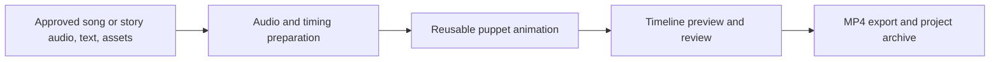

> Reference design adapted from the supplied v1.1 blueprint. Name updated to InteractiveStudio on 2 November 2026. This describes intended scope; see ROADMAP.md for current implementation status.

# InteractiveStudio

**Implementation Blueprint, Version 1.1**  
*Personalised songs, stories and visual learning. A local-first, audio-driven video creation framework.*

Build engaging, adaptable videos that teach everyday routines, communication, early learning, and confidence through familiar songs and stories. The first implementation turns approved Suno tracks and reusable original characters into editable 2D animations, without a dedicated GPU or additional metered AI APIs. The framework is designed to expand to spoken stories, social situations and visual routines.

> **PURPOSE** Initially designed around a five-year-old child beginning Reception in the UK, with the flexibility to accommodate different interests, communication styles, attention spans and sensory preferences. Do not assume one learning format works for every child. This is an educational and creative tool, not a diagnostic or therapeutic intervention.

> **NAMING** *InteractiveStudio* is a working product name, not a trademark or domain-availability claim. A public YouTube channel may use a distinct name.



> **CORE DECISION** Build a reusable 2D puppet-animation and timeline system. Do not train a generative-video model or regenerate every frame with AI.

| **Designed for**        | **Operating assumption**                                               |
|-------------------------|------------------------------------------------------------------------|
| **Computer**            | Windows PC, CPU-only rendering                                         |
| **Already available**   | Paid Suno, ChatGPT and Gemini subscriptions                            |
| **Generative workflow** | Manual asset and storyboard creation in subscription interfaces        |
| **Output**              | Personalised songs, stories and learning videos, initially 1920 x 1080 H.264 MP4 |
| **First deliverable**   | One polished 20-30 second singing clip, then a full 2-3 minute episode |

Prepared: 1 November 2026 \| Status: Proposed implementation plan \| Owner: Project team

# 1 Executive decisions

Purpose. Create an editable Windows-based studio for songs, stories and everyday-learning videos. Reuse approved character rigs, scenes and motion presets while adapting pace, visuals and topics to the learner. Each video should be meaningful, easy to follow and educational, not an interchangeable template clone.

| **Decision**        | **Chosen approach**                                       | **Why**                                          |
|---------------------|-----------------------------------------------------------|--------------------------------------------------|
| **Source of truth** | Approved audio + lyrics/transcript + episode project                 | Precise timing, revision and reproducibility     |
| **Creative assets** | Generate or commission manually; import layered originals | Avoid API usage and prevent character drift      |
| **Animation**       | 2D rigging, mouth sprites, procedural motion              | Reliable CPU rendering and consistent identity   |
| **Lip-sync**        | Rhubarb on isolated vocal stem; edit exceptions           | Practical baseline with quality control          |
| **Visual editor**   | Local React/TypeScript dashboard                          | Fast approvals without hand-editing code         |
| **Renderer**        | Remotion + FFmpeg                                         | Frame-based programmatic production              |
| **AI models**       | Optional and deferred                                     | No GPU required for core product                 |
| **Publishing**      | Manual YouTube upload initially                           | Keep rights, child safety and originality checks |

## Goals and non-goals

| **In scope for version 1**                                 | **Explicitly out of scope for version 1**                        |
|------------------------------------------------------------|------------------------------------------------------------------|
| **Import one song or narration track; vocal stem optional** | Automatic generation of music or narration inside the studio |
| **One lead singing character and supporting characters**   | Fully automatic multi-singer voice-to-character attribution      |
| **Reusable mouth, movement and camera presets**            | 3D animation, physics simulation or full text-to-video           |
| **Editable timeline, scene templates, preview and export** | Hands-free production without editorial review                   |
| **Local files and no metered AI calls**                    | Automatic scraping or robot control of ChatGPT/Gemini interfaces |

## What success means

- The second episode can be produced without rebuilding a rig or rewriting rendering code.

- Every scene, action and mouth cue can be corrected without recreating the music.

- The full video can be rendered twice with identical results from the saved project.

- A human approves the educational content, visual quality, ownership records and publication settings.

- Compute remains manageable on a CPU-only Windows machine using a low-resolution preview mode.

# 2 The end-to-end creator workflow

1.  Approve the audio: for a song, download the final Suno mix, optional isolated vocal stem and verified lyrics; for a spoken story, provide a recorded narration and transcript. Keep source/rights evidence.

2.  Create an episode: drag in audio, paste approved lyrics or narration text, select topic, characters, intended learning outcome and accessibility profile.

3.  Analyse audio: measure length and peaks, propose beats and sections; produce speech-style mouth cues from the vocal stem.

4.  Review timing: correct verse boundaries, singer assignment, word or syllable regions and suspicious mouth cues.

5.  Choose a template: counting, animal action, everyday routine, colours, bedtime or narrated story; populate its scene slots.

6.  Build storyboard: optionally paste an AI-generated JSON storyboard from ChatGPT/Gemini, validate IDs and timing, then approve.

7.  Generate animation: select approved poses, gestures, movements, backgrounds and simple camera shots.

8.  Preview and revise: adjust scenes, character placement, lyric timings and mouth shapes on a timeline.

9.  Run preflight checks: count accuracy, rights, missing assets, audio sync, child suitability and sufficient originality.

10. Export: render an MP4, thumbnail draft, project archive and publication checklist for human sign-off.

> **CRITICAL SEPARATION** AI may propose a creative plan; code must validate and render it deterministically. The approved audio and lyrics/transcript outrank any guess made by speech recognition or an LLM.

# 3 System architecture


## Software components

| **Component**         | **Responsibility**                                     | **Implementation**                        |
|-----------------------|--------------------------------------------------------|-------------------------------------------|
| **Local web app**     | Projects, assets, waveform, storyboard, editor, review | React + TypeScript + Vite; localhost only |
| **Project service**   | Save/load episode state and track revisions            | Node.js service + SQLite and JSON files   |
| **Audio worker**      | Probe formats, calculate waveforms, beats/energy       | FFmpeg/ffprobe; optional Python/librosa   |
| **Lip-sync worker**   | Generate mouth-cue JSON from voice stem                | Rhubarb CLI; manual cue-edit fallback     |
| **Animation library** | Render puppets, gestures and camera layouts            | React components + SVG/PNG layers         |
| **Render worker**     | Create preview and final video                         | Remotion CLI + FFmpeg                     |
| **Validation**        | Schema, timing, assets, rights and educational checks  | TypeScript validators and checklists      |

## Design rules

- Keep authored project data separate from generated files. Never overwrite an approved song or source illustration.

- Save timestamps in seconds with explicit floating-point values; convert to video frames only at render time.

- Make automated stages repeatable and cache results by input-file hash and settings version.

- Store a project version, random seed and renderer version for reproducible results.

- Start with one lead singer; mark backing vocals and overlapping singers as unsupported or manual.

- Each editor operation must support undo, save and an obvious preview of its effect.

- Run local by default. External services are used only when the creator manually chooses to upload or paste assets.

# 4 Audio processing: Suno songs first, narration next

## Input contract

| **Input**                    | **Required?** | **Notes**                                                                    |
|------------------------------|---------------|------------------------------------------------------------------------------|
| **master.wav or master.mp3** | Yes           | Final approved mix for final video; preserve the source file.                |
| **vocals.wav**               | Recommended   | Clean lead-vocal stem from Suno for better lip-sync.                         |
| **lyrics.txt / transcript.txt** | Yes        | Human-approved words actually sung or spoken, not merely a prompt.         |
| **audio_source.json**        | Yes           | Track/recording ID, source, dates, paid plan/licence evidence and rights notes. |
| **instrumental.wav**         | Optional      | Useful for special effects and timing, not needed in v1.                     |

## Audio pipeline and output

1. Probe master and vocal files: duration, channels, peak, sample rate and clipping.

2. Convert a temporary copy of vocals to Rhubarb-compatible WAV or Ogg; keep original audio unchanged.

3. Calculate low-resolution waveform data for editor scrubbing and rough loudness/energy markers.

4. Estimate beats and musical section boundaries; mark all detections as suggestions, not ground truth.

5. Run Rhubarb with verified lyrics or narration as an optional dialogue hint to create time-coded mouth shapes.

6. Provide drag-to-correct sections, singer ranges, cue boundaries and sustained-vowel holds.

7. Store approved timing in timing.json and mouth-cues.json, distinct from generated raw guesses.

```powershell
rhubarb -f json -r pocketSphinx -d lyrics.txt -o mouth-cues.json vocals.wav
```

Caution: Rhubarb is designed around speech. Singing, long vowels, harmonies and busy mixtures can cause inaccurate cues. Use the isolated vocal stem when available; expose manual timing and cue repair. It is not a reliable sung-word forced aligner.

## Suggested audio worker data

```json
{
  "durationSec": 142.3,
  "sampleRateHz": 48000,
  "estimatedBpm": 102,
  "bpmConfirmed": false,
  "sections": [
    {"id": "verse-1", "startSec": 8.0, "endSec": 32.0, "reviewed": true}
  ]
}
```

# 5 Asset and character rig specification

For predictable animation, each character must be an editable puppet, not one flattened image. Start with flat transparent PNG layers. Add SVG support for scaling and later rig tooling.

## Minimum character package

| **Asset**            | **Specification**                               | **Validation**                            |
|----------------------|-------------------------------------------------|-------------------------------------------|
| **Body + head**      | Consistent canvas scale, transparent PNG or SVG | No baked-in mouth, transparent background |
| **Mouth variants**   | At least Rhubarb A-F and idle X; G/H optional   | Same origin, size and character style     |
| **Eye states**       | Open, blink, smile/happy optional               | No face shifting on swaps                 |
| **Arms/legs/tail**   | Independent layers where needed                 | Correct pivots and z-order                |
| **Rig manifest**     | Layer paths, anchor points, scale and variants  | Missing files block export                |
| **Movement presets** | Idle, bounce, walk, jump, dance, point, wave    | Loop-safe and visually reviewable         |

## Starter library for the first episode

- One lead singing kangaroo, plus four supporting kangaroo sprites or simpler poses.

- One meadow environment with front/middle/background separation.

- Two reusable props such as a flower and a stepping stone.

- One lead-singer mouth set, open/closed eyes and basic limb movement.

- Four motion presets: idle, bounce/dance, jump and wave.

- One number display object whose value is driven by the verified story state.

> **ART WORKFLOW** Create character reference sheets in ChatGPT or Gemini, then manually prepare transparent, aligned layer files. Do not expect generative images to provide stable identical facial parts automatically.

# 6 Storyboard and animation rules

## Recommended templates

| **Template**             | **State model**                                         | **Primary shots**                 |
|--------------------------|---------------------------------------------------------|-----------------------------------|
| **Counting subtraction** | starting count → character leaves → remaining count | Group, event, count confirmation  |
| **Animal action**        | character + action + location                           | Wide, moving character, close-up  |
| **Daily routine**        | ordered action steps, completed state                   | Action, explanation, result       |
| **Colours/shapes**       | current highlighted object/colour                       | Object close-up, group sorting    |
| **Bedtime**              | slow scene transitions and low movement                 | Soft wide shot, gentle expression |

## Animation intelligence without generative video

- Mouth shapes follow time-coded cues for explicitly assigned singing windows.

- Body moves are parameterised animation curves tied to musical beats or action timestamps.

- The template chooses scenes from approved backgrounds, props, layouts and gestures.

- Camera motion is deliberately modest; avoid rapid cuts, flashing and unnecessary visual noise.

- Educational visuals are state-driven, not image-generation guesses. If the lyric says four, show exactly four.

- Random variation may choose among safe presets, but must be seeded and reproducible.

## Human + LLM storyboard handoff

The app offers a Copy Storyboard Request action including audio sections, approved lyrics/transcript, available character IDs, prop IDs, backgrounds, accessibility settings and supported motions. Paste into ChatGPT or Gemini, then import its JSON response. This does not require a paid API.

The importer rejects unknown assets, timestamps outside the song, unsupported motions, or incorrect educational states. It reports errors in plain English instead of silently improvising.

```json
{
  "schemaVersion": 1,
  "episodeId": "five-little-kangaroos-001",
  "fps": 30,
  "seed": 73,
  "audio": {"master": "audio/master.wav", "vocals": "audio/vocals.wav"},
  "scenes": [
    {
      "id": "intro", "startSec": 0, "endSec": 8,
      "backgroundId": "meadow-day",
      "characters": ["roo-1", "roo-2", "roo-3", "roo-4", "roo-5"],
      "actionId": "group-bounce", "cameraId": "wide"
    },
    {
      "id": "count-four", "startSec": 8, "endSec": 18,
      "backgroundId": "meadow-day",
      "characters": ["roo-2", "roo-3", "roo-4", "roo-5"],
      "actionId": "count-pose", "visibleCount": 4, "cameraId": "wide"
    }
  ]
}
```

Example timestamps are placeholders only. Actual cuts and count changes must be approved against the performed song.

# 7 Local editor and operating screens

| **Screen**     | **Creator actions**                                    | **Core acceptance criteria**               |
|----------------|--------------------------------------------------------|--------------------------------------------|
| **Audio**      | Import music or narration, edit text and sections    | WAV plays in sync; sections editable       |
| **Library**    | Import/preview rigs, mouths, props and backgrounds     | Every asset ID resolves; rig preview works |
| **Storyboard** | Pick template, import AI JSON, approve scenes          | Invalid JSON gets clear feedback           |
| **Timeline**   | Scrub, move cues, select poses, adjust camera and cuts | Changes save and re-preview                |
| **Review**     | See preflight warnings and frame snapshots             | Critical failures block final export       |
| **Export**     | Choose preset, render preview/final and archive        | Reliable MP4 with locked audio sync        |

## Usability requirements

- Use a persistent project autosave and manual version checkpoints.

- Support drag-to-import assets and straightforward replacement of a character or background.

- Provide keyboard play/pause, timeline zoom, snapping to beats and waveform display.

- Clearly distinguish generated suggestions from approved editorial data.

- Let the user re-render only a scene preview during correction; defer partial final-video caching until later.

- Include an Export Diagnostics panel with duration, missing assets, format and renderer errors.

# 8 Rendering, output and file organisation

## Export presets

| **Preset**           | **Video**                          | **Audio**       | **Use**                           |
|----------------------|------------------------------------|-----------------|-----------------------------------|
| **Draft**            | 854 x 480, 24 fps, fast encode     | Original master | Quick full-length quality review  |
| **Standard YouTube** | 1920 x 1080, 30 fps, H.264/yuv420p | AAC 48 kHz      | Initial public episodes           |
| **Shorts crop**      | 1080 x 1920, 30 fps                | AAC 48 kHz      | Later, with explicit 9:16 layouts |

Video duration follows the approved master. The renderer should fail explicitly on missing frames or invalid durations and preserve the log. Benchmark concurrent render workers on the actual CPU and RAM; use low concurrency by default.

## Suggested local folder structure

```text
interactive-studio/
├── app/                         # React editor
├── server/                      # Local Node service and job runner
├── renderer/                    # Remotion compositions
├── workers/                     # FFmpeg, Rhubarb, optional Python
├── templates/                   # Approved scene rule sets
├── assets/
│   ├── characters/             # Layered rigs and manifests
│   ├── backgrounds/
│   ├── props/
│   └── motions/
├── episodes/
│   └── five-little-kangaroos-001/
│       ├── audio/
│       │   ├── master.wav
│       │   └── vocals.wav
│       ├── lyrics.txt
│       ├── audio_source.json
│       ├── project.json
│       ├── timing.json
│       ├── mouth-cues.json
│       ├── storyboard.json
│       └── export/              # MP4, thumbnail, logs, metadata
└── studio.sqlite
```

## Version and dependency policy

Record application build, input hashes, FFmpeg/Rhubarb/Remotion versions, rendering preset and last approval date in an export manifest. Use project-relative file paths so an archived episode can be reopened on another computer.

# 9 Rights, quality assurance and publishing gates

## Rights ledger for every episode

| **Required evidence** | **What to store**                                                                        |
|-----------------------|------------------------------------------------------------------------------------------|
| **Underlying song**   | Composition/lyrics title, source, public-domain or licence basis and territory reviewed  |
| **Suno master**       | Song identifier, account plan, generation and download timestamps, ownership/usage notes |
| **Restrictions**      | Whether output is a Remix, third-party material, or otherwise subject to extra review    |
| **Artwork**           | Asset creator/source, generation/commission date, licences or permission documents       |
| **Export record**     | Final approval name/date, audio source hash, disclosure status and upload URL later      |

Traditional nursery rhymes are not universally copyright-free in every version. New lyrics, arrangements, illustrations and recordings may have separate rights. Store proof for the specific material used. Suno commercial-use rights depend on its current terms and the song’s eligibility; confirm before publishing.

## Automatic preflight checks

- All required assets exist, are readable, have supported transparency and resolve through the manifest.

- Scene boundaries are ordered, nonoverlapping where required, and within the audio duration.

- Mouth cues are assigned only to the designated singer and cannot extend beyond the vocal timing.

- No gaps or blank frames are present unless an intentional fade is marked.

- Visible counts, colour labels and other learning-state values match the approved storyboard.

- Output contains an audio stream and a video stream, with acceptable start/end sync.

- Rights/status fields and review decisions are complete before export approval.

## Human release checklist

- Listen for voice distortion, offensive or incorrect lyrics, sudden loudness and inconsistent musical sections.

- Watch the entire video for odd expressions, accidental scary frames, strobing, character overlap or confusing cuts.

- Verify counting, letters, shapes and other educational elements against approved lyrics.

- Confirm substantial creative variation from prior episodes, not only a superficial animal substitution.

- Classify the video correctly as Made for Kids and complete YouTube’s applicable AI-music disclosure.

- Publish manually after reviewing current platform policies and permissions.

> **PUBLISHING POSTURE** Approval is a real stop in the workflow. Do not make a green "publish-ready" indicator solely from automated checks; it requires explicit human sign-off.

# 10 Development phases and exit criteria

| **Phase**                 | **Build**                                                                             | **Exit gate**                                                 |
|---------------------------|---------------------------------------------------------------------------------------|---------------------------------------------------------------|
| **P0 \| Technical proof** | Audio import, one kangaroo rig, Rhubarb cues, basic Remotion scene, MP4 export        | 20-30 second clip with plausible singing and clean audio      |
| **P1 \| Full episode**    | Multiple scenes, four motion presets, scene JSON, low-res preview, project save/load  | Produce a 2-3 minute episode with reusable assets             |
| **P2 \| Editor MVP**      | Waveform, editable sections, cue/timeline editor, storyboard JSON import, narration mode and validation | Fix a wrong mouth cue or scene without changing code |
| **P3 \| Studio v1**       | Asset library, templates, queued rendering, quality/rights preflight, release package | Second song reuses assets with substantially less effort      |
| **P4 \| Expansion**       | 9:16 layouts, personalised visual schedules, multilingual timing, better singing alignment | Add capabilities only when validated learning or editorial needs justify them |

## Priority engineering backlog

| **Priority** | **Work item**                                  | **Acceptance test**                               |
|--------------|------------------------------------------------|---------------------------------------------------|
| **P0**       | Create project format and folder layout        | Reopen saved test project with identical settings |
| **P0**       | Import song, lyrics and optional vocal stem    | Probe duration and render waveform                |
| **P0**       | Character rig and mouth-shape renderer         | Mouth cues swap correctly at chosen times         |
| **P0**       | Remotion render worker                         | Local H.264 video with original song              |
| **P1**       | Scene templates and movement presets           | One kangaroo can idle, jump, wave and dance       |
| **P1**       | Editable section/scene timing                  | Corrections persist through restart               |
| **P1**       | Asset manifest validation                      | Missing or mismatched mouth states flagged        |
| **P1**       | Human approval and export manifest             | Cannot mark ready without rights/review sign-off  |
| **P2**       | AI storyboard copy/paste JSON loop             | Invalid IDs rejected with actionable errors       |
| **P2**       | Multiple characters and count-state assertions | Exactly N animals shown in test scene             |

# 11 First production: Five Little Kangaroos

Use this working episode as a test fixture. It is a proposed creative variant, not a statement that any particular adaptation has been rights-cleared.

## First concrete demo

| **Scope**             | **Decision**                                                                     |
|-----------------------|----------------------------------------------------------------------------------|
| **Song excerpt**      | Approved 20-30 seconds from Suno, with master + vocal stem                       |
| **Character**         | One animated lead kangaroo; other animals can be simpler sprites                 |
| **Environment**       | One meadow background                                                            |
| **Animation**         | Mouth, blink, bounce, jump; one camera cut                                       |
| **Educational event** | Show five animals, then four after a clear departure                             |
| **Acceptance**        | No missing frames; no wrong count; lip-sync plausible; editable and rerenderable |

## Suggested first work session

1. Create the project folder and import an approved 20-30 second song excerpt and verified lyrics.

2. Generate one consistent kangaroo character image; separate head, body, eyes and mouth variants.

3. Create character.json with layer paths, pivots, baseline size and mouth-sprite mapping.

4. Generate Rhubarb mouth cues from vocals.wav and inspect the cues against the waveform.

5. Render the singer in a single scene with idle movement and mouth swaps.

6. Add one jump animation and one counting scene; export a low-resolution MP4.

7. Correct the most visible failures and export a full-resolution demo.

8. Archive the project, rights notes and render manifest to prove repeatability.

## Minimum acceptance checklist

☐ Input audio, approved lyrics/transcript and rights record saved

☐ One lead rig with mouth set prepared

☐ Audio and visible mouth animation reasonably aligned

☐ At least two scene types and a reusable motion preset

☐ Count-state test passes for visible animals

☐ Preview and final MP4 successfully rendered

☐ Project reopens and exports deterministically

☐ Full human creative and compliance review recorded

# 12 Risks, choices and expansion rules

| **Risk**                   | **Likely failure**                          | **Mitigation**                                            |
|----------------------------|---------------------------------------------|-----------------------------------------------------------|
| **Singing lip-sync**       | Vowel jitter or wrong mouth movement        | Use vocal stem; manual cue editor; sustained-vowel rules  |
| **Character consistency**  | Generated art changes identity each episode | Approved reusable character rigs; no per-frame generation |
| **LLM storyboard quality** | Imaginary props or unrenderable actions     | Constrained asset IDs and schema validation               |
| **Educational errors**     | Incorrect counting and confusing visuals    | Template state machine + preflight count assertions       |
| **CPU performance**        | Slow final renders                          | Low-res previews, scene simplicity, limited concurrency   |
| **Repetitive content**     | Near-identical videos fail to build trust   | Real original story/actions, editorial originality check  |
| **Rights/licensing**       | Unclear song/arrangement/art permission     | Per-item rights ledger, no release on unknown status      |
| **Scope creep**            | Large editor built before proof works       | Ship P0 30-second demo before investing in P2/P3          |

## Deferred optional AI models

A GPU is not necessary for the planned core. If manual transcription or timing becomes a genuine bottleneck, test CPU-capable whisper.cpp on short isolated vocal stems. For detailed sung-word alignment, evaluate carefully rather than treating general speech ASR as reliable. A small local language model is not needed for predictable scene layout, movement or count-state logic.

## Change-management rule

Add a new model, service or generative feature only if it clearly improves one measured issue: quality, time to approve, error rate, cost per minute or original creative range. Avoid architectural changes based solely on novelty.

# 13 Child-centred learning, accessibility and privacy

The framework should optimise for **one learner understanding and enjoying the material**, not for maximising video volume, cuts, or watch time. The same foundation can later support more learners and a public channel, but the initial workflow should work privately.

## Learning pathways to support

| **Pathway** | **Example videos** | **Production treatment** |
|---|---|---|
| Everyday routines | Getting ready for school, washing hands, tidying up, bedtime | Short, predictable step-by-step sequences; repeatable wording |
| Communication and choices | Asking for help, choosing an activity, saying how you feel | Clear modelling, useful pauses, words plus visual cues |
| UK Reception learning | Initial sounds, simple counting, shapes, patterns, days, classroom routines | One learning objective per video; check against the child's current teaching |
| Social situations | Taking turns, waiting, joining play, transitions | Familiar characters act out situations without shaming or pressure |
| Safety and independence | Road crossing with an adult, safe hands, dressing skills | Concrete action sequences and adult-reviewed accuracy |
| Stories for enjoyment | Favourite characters, adventures, repeatable narrative sequences | Simple plots, repetition, recognisable cues and gentle resolution |

**Important:** Reception teaching varies by school and learner. The content library should allow family and school guidance to shape objectives rather than automatically assuming age-specific attainment or preferred methods.

## Optional learning and sensory preferences

Store a **local-only, optional learner profile**. Keep defaults neutral; do not infer needs from a diagnosis or label. Possible settings:

- Preferred characters, interests, familiar names or objects, and topics to practise.
- Visual density: simple/standard; predictable transitions; optional reduced motion.
- Pace: slow/standard; longer pauses for processing or responses.
- Audio: softer transitions, narration prominence, fewer overlapping sounds.
- Communication supports: optional captions, pictograms, consistent visual cue cards and repeated phrases.
- Structure: visual 'first / then / finished' markers, short chapters and clear end cues.

Every adaptation must be configurable per video, with a preview and a manual override. Do not interpret profile settings as medical advice or guaranteed methods of learning.

## A second content workflow: narrated stories

**Song mode (first build):** master song + optional isolated vocals + verified lyrics → timing and lip-sync → storyboard → render.

**Story mode (next build):** approved narration + transcript → speech mouth cues → scene/character assignments → optional soft background music → render.

Both modes share the same asset library, timeline, motion system, review checks and MP4 exporter. Avoid building a second renderer for stories.

## Privacy and publishing rules

- Keep learner profiles, personal photos, family names, school names, recordings and routine details private by default and stored locally.
- Do not automatically include identifiable personal details in prompts sent to third-party tools or in public YouTube uploads.
- Separate **private personalised exports** from **public channel editions**. Create public versions using fictional characters and non-identifying examples.
- Only include a child's real image or voice if a responsible adult deliberately approves its use and understands where it will be shared.
- Treat educational appropriateness and emotional comfort as explicit human review gates.

## Personalised pilot after the technical demo

Once the *Five Little Kangaroos* lip-sync proof works, create **Getting Ready for Reception**, a short original song or story with 4–6 clearly illustrated steps drawn from an adult-approved routine. Offer a slow/predictable version and a standard version, with the same character rig and editor. Evaluate whether the learner follows and enjoys it through direct observation, rather than assuming YouTube view metrics indicate learning.

**Acceptance criteria:** a caregiver can change the routine's steps, swap pictures, slow down the pace, add a deliberate pause, and export a private version without editing code. The episode remains fully editable and reproducible.

# 14 Source links and policy watchlist

The following are primary documentation links supporting key tool and policy decisions. Recheck vendor licensing and YouTube rules before launch or commercial use.

**Suno: paid subscription usage rights:** https://help.suno.com/en/articles/9601665

**Suno: obtaining stems:** https://help.suno.com/en/articles/13925185

**Suno: advanced stem separation:** https://help.suno.com/en/articles/12702337

**Rhubarb Lip Sync: CLI, recognizers, mouth cues:** https://github.com/DanielSWolf/rhubarb-lip-sync

**Remotion: licence and pricing:** https://www.remotion.dev/docs/license/pricing

**Remotion: licence terms:** https://www.remotion.dev/docs/terms

**YouTube: best practices for kids and family:** https://support.google.com/youtube/answer/10774223

**YouTube: monetisation policies:** https://support.google.com/youtube/answer/1311392

**YouTube: setting Made for Kids audience:** https://support.google.com/youtube/answer/9527654

**YouTube: disclosure of generative AI content:** https://support.google.com/youtube/answer/14328491

> **IMPLEMENTATION ORDER** Prove the audio-to-character-to-MP4 path first. Next support a useful everyday-learning song, then a narrated story. Add accessibility preferences, reusable assets, scene templates and editing tools only as the core render path works.

End of blueprint \| Proposed design subject to testing, tool compatibility, current licensing and policy review.


