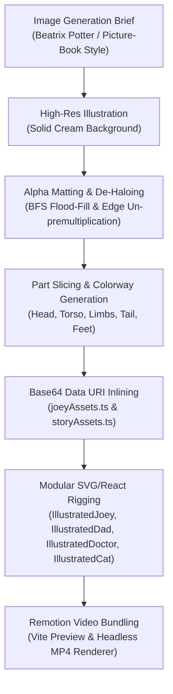

# Option B: Illustrated 2.5D Storybook Pipeline

Technical Reference · InteractiveStudio · November 2026

This document details the architecture, image processing algorithms, and SVG/React rigging used to deliver the Option B warm 2.5D illustrated picture-book production.

---

## 1. Pipeline Overview

---

## 2. Image Processing & De-Haloing

Generated characters on paper backgrounds contain watercolor grain and warm tinted paper fibers (e.g. `RGB ≈ 246, 239, 219`). Standard color-keying leaves ugly white fringes or dark jagged halos.

### The De-Haloing Algorithm

1. **Outer Boundary Sampling**: Sample image perimeter pixels to determine exact background paper tone $(R_{bg}, G_{bg}, B_{bg})$.
2. **BFS Flood-Fill from Borders**: Flood from all four image boundaries, classifying pixels by color distance:
   $$\text{dist} = \sqrt{(R - R_{bg})^2 + (G - G_{bg})^2 + (B - B_{bg})^2}$$
   This ensures cream patches *inside* the character (such as chest patches, white collars, or lab coats) are not accidentally cut away.
3. **Soft Alpha & Color Un-premultiplication**:
   For transition edge pixels with alpha $\alpha \in (0, 1)$:
   $$R_{clean} = \max\left(0, \min\left(255, \frac{R_{sample} - (1 - \alpha) R_{bg}}{\alpha}\right)\right)$$
   This strips the tinted background paper color out of semi-transparent fur and whisker pixels, eliminating the halo completely.
4. **Sticker Rim Removal**: For spot illustrations (such as the sleeping cat), any outer die-cut white border is flood-filled and trimmed so the subject blends directly into the scene.

---

## 3. Asset Modules & Base64 Data URI Inlining

External image file paths (`file://` or relative URLs) introduce latency, CORS restrictions, and path-resolution failures when rendering through Remotion's headless Chrome instances.

All processed assets are converted to Base64 strings and exported as TypeScript constants:

| Asset File | Output TS File | Exported Identifier | Purpose |
|---|---|---|---|
| `storybook_bedroom_bg.jpg` | `storyAssets.ts` | `storybookBedroomDataUri` | 1920×1080 Widescreen Bedroom Background |
| `storybook_clinic_bg.jpg` | `storyAssets.ts` | `storybookClinicDataUri` | 1920×1080 Widescreen Clinic Background |
| `daddy_kangaroo.png` | `storyAssets.ts` | `daddyKangarooDataUri` | Full-body adult kangaroo father |
| `doctor_kangaroo.png` | `storyAssets.ts` | `doctorKangarooDataUri` | Full-body kangaroo doctor |
| `sleeping_cat.png` | `storyAssets.ts` | `sleepingCatDataUri` | Curled sleeping kitten on braided rug |
| `joey/head.png` | `joeyAssets.ts` | `headDataUri` | Baby kangaroo head & ears |
| `joey/tail.png` | `joeyAssets.ts` | `tailDataUri` | Baby kangaroo tripod tail |
| `joey/foot_left.png` | `joeyAssets.ts` | `footLeftDataUri` | Near hind foot (3/4 angle) |
| `joey/foot_right.png` | `joeyAssets.ts` | `footRightDataUri` | Far hind foot (horizontal ground) |
| `joey/torso_*.png` | `joeyAssets.ts` | `COLORWAY_TORSOS` | 5 bedtime pajama colorways |
| `joey/arm_*.png` | `joeyAssets.ts` | `COLORWAY_ARMS_*` | Left and right pajama arms |

---

## 4. Rigging Architecture

### 4.1 IllustratedJoey Rigging (`IllustratedJoey.tsx`)

Layer stack inside the root `<g>` transform:
1. **Contact Shadow**: Scaled dynamically with bounce height (`ellipse cx="10" cy="2"`).
2. **Layer 1 (Tail)**: Anchored at pelvic base `(-68, 95)` behind body, counter-swinging with bounce phase:
   $$\text{tailSwing} = \cos(\text{phase} - 0.5) \times 11^\circ$$
3. **Layer 2 (Hind Feet)**: Macropod horizontal feet placed at `y = 136..142`, grounded under pajama leg cuffs.
4. **Layer 3 (Torso)**: Pajama body with distinct colorway patterns and star prints.
5. **Layer 4 (Limbs)**: Left and right arms with shoulder pivots `(-42, -72)` and `(38, -72)`, supporting bounce arm-flaps, leaps, and waves.
6. **Layer 5 (Head & Face)**: Head graphic with dynamic blinking eyelids and phoneme mouth shapes (`A` through `H`) aligned over the illustrated snout.

### 4.2 IllustratedDad Rigging (`IllustratedDad.tsx`)

1. **Base Pose**: Stands by bedroom door (`x = 1510, y = 930`).
2. **Leap Reaction**: Reacts with squash-and-stretch when a joey leaps and lands on his head.
3. **Phone Pose**: Displays dark teal smartphone and raised paw held up to ear (`translate(30, -362)`).
4. **Waving Pose**: Waving arm animation during family finale.
5. **Lip-Sync**: Expressive mouth phonemes overlaying muzzle during sung lines.

### 4.3 IllustratedDoctor Rigging (`IllustratedDoctor.tsx`)

1. **Base Pose**: Stands in pediatric clinic (`x = 985, y = 932`).
2. **Phone Consultation**: Holds phone to ear during dialogue exchange with Dad.
3. **Advisory Gesture**: Animated wagging pointing paw (`(82, -214)`) when singing *"No more kangaroos jumping on the bed!"*.
4. **Singing Lip-Sync**: Phoneme overlays for dialogue delivery.

### 4.4 IllustratedCat Rigging (`IllustratedCat.tsx`)

1. **Idle State**: Curled peacefully on teal braided rug with soft respiratory bobbing (`Math.sin(time * 2.2) * 1.5`).
2. **Startled State**: Cute alert eyes and startle hop during the reaction cutaway.

---

## 5. Sets & Staging Alignment

1. **Bed Group Coordinates**:
   $$\text{bedX}(i) = 580 + (i - 1) \times 155 \quad \text{for } i \in [1, 5]$$
   Places the five kangaroos between $x = 580$ and $x = 1200$ directly atop the illustrated toddler bed's mattress and purple quilt at $y = 788$.
2. **Leap Trajectory**:
   $$\begin{aligned}
   x(p) &= x_{\text{start}} + (1510 - x_{\text{start}}) \times p \\
   y(p) &= 788 + (535 - 788) \times p - 220 \times 4p(1 - p) \\
   \text{rot}(p) &= -18^\circ + 27^\circ \times p
   \end{aligned}$$
   Creates a smooth parabolic arc from the bed onto Daddy Kangaroo's head/shoulders.
